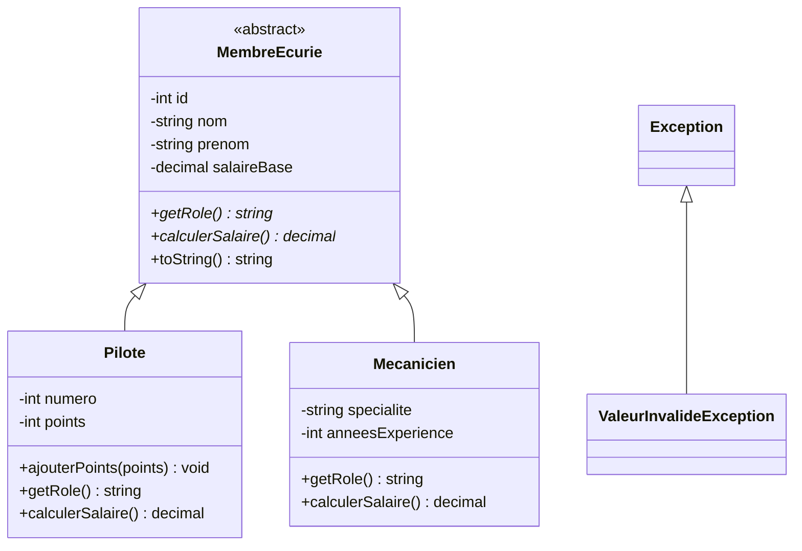

# Rapport de mission – MiniProjet Héritage (PHP et C#) : Formule 1

## 1. Dépôt GitHub
https://github.com/badmitio/TP-groupe-php (branche `f1-php`)

```
PHP/      -> classes PHP, tests, script SQL
CSharp/   -> solution Visual Studio : dll MiniProjet_F1_Bibli + console de test MiniProjet_F1_Tests
```

## 2. Domaine fonctionnel : le personnel d'une écurie de F1
Une écurie emploie des **pilotes** et des **mécaniciens**. Ils ont des informations communes
(nom, prénom, salaire de base) mais un rôle et un calcul de salaire différents.

| Classe | Champs propres | Salaire |
|---|---|---|
| `MembreEcurie` (mère, abstraite) | id, nom, prénom, salaire de base | abstrait |
| `Pilote` (fille) | numéro (1 à 99), points | base + 1 000 € par point |
| `Mecanicien` (fille) | spécialité, années d'expérience | base + 500 € par année d'expérience |

- **Polymorphisme** : une liste de `MembreEcurie` contient pilotes et mécaniciens ; `GetRole()`, `CalculerSalaire()` et `ToString()` donnent un résultat différent selon la classe réelle.
- **Exception** : `ValeurInvalideException` est levée pour un nom vide, un numéro hors de 1..99, des points négatifs, un salaire négatif, etc.

## 3. Diagramme de classes (UML)



(Le diagramme s'affiche directement sur GitHub ; faire une capture d'écran pour Pronote.)

## 4. Tables MySQL
Table mère `membre_ecurie`, tables filles `pilote` et `mecanicien` : leur clé primaire `id` est aussi une clé
étrangère vers `membre_ecurie`. Les champs des classes sont identiques aux colonnes des tables.

> À faire : captures d'écran de `SHOW TABLES;`, de `DESCRIBE` pour les 3 tables et de leur contenu.

### Code SQL (`PHP/sql/f1_heritage.sql`)
```sql
-- MiniProjet F1 (PHP / C#) - Héritage
--   membre_ecurie (table mère)  <--  pilote (fille)
--                               <--  mecanicien (fille)
-- La clé primaire des tables filles est aussi une clé étrangère vers la table mère.

CREATE DATABASE IF NOT EXISTS f1_heritage CHARACTER SET utf8mb4;
USE f1_heritage;

DROP TABLE IF EXISTS mecanicien;
DROP TABLE IF EXISTS pilote;
DROP TABLE IF EXISTS membre_ecurie;

-- Table mère
CREATE TABLE membre_ecurie (
    id            INT AUTO_INCREMENT PRIMARY KEY,
    nom           VARCHAR(50)   NOT NULL,
    prenom        VARCHAR(50)   NOT NULL,
    salaire_base  DECIMAL(10,2) NOT NULL DEFAULT 0
);

-- Table fille : Pilote
CREATE TABLE pilote (
    id      INT PRIMARY KEY,
    numero  INT NOT NULL UNIQUE,
    points  INT NOT NULL DEFAULT 0,
    FOREIGN KEY (id) REFERENCES membre_ecurie (id) ON DELETE CASCADE
);

-- Table fille : Mecanicien
CREATE TABLE mecanicien (
    id                 INT PRIMARY KEY,
    specialite         VARCHAR(50) NOT NULL,
    annees_experience  INT NOT NULL DEFAULT 0,
    FOREIGN KEY (id) REFERENCES membre_ecurie (id) ON DELETE CASCADE
);

-- Jeu d'essai (une ligne dans la table mère + une ligne dans la table fille)
INSERT INTO membre_ecurie (id, nom, prenom, salaire_base) VALUES (1, 'Leclerc',  'Charles', 20000);
INSERT INTO membre_ecurie (id, nom, prenom, salaire_base) VALUES (2, 'Hamilton', 'Lewis',   25000);
INSERT INTO membre_ecurie (id, nom, prenom, salaire_base) VALUES (3, 'Rossi',    'Mario',    3000);

INSERT INTO pilote (id, numero, points) VALUES (1, 16, 25);
INSERT INTO pilote (id, numero, points) VALUES (2, 44, 40);

INSERT INTO mecanicien (id, specialite, annees_experience) VALUES (3, 'Moteur', 10);
```

## 5. Code source des classes métiers

### PHP

#### PHP/src/MembreEcurie.php
```php
<?php

require_once __DIR__ . '/ValeurInvalideException.php';

/**
 * Classe MÈRE : un membre du personnel d'une écurie de F1.
 * Table MySQL : membre_ecurie.
 */
abstract class MembreEcurie
{
    // #region Champs privés

    private $id = 0;
    private $nom = 'inconnu';
    private $prenom = 'inconnu';
    private $salaireBase = 0;

    // #endregion

    // #region Constructeur

    /**
     * Constructeur de la classe mère, appelé par les filles avec parent::__construct().
     */
    public function __construct($nom = 'inconnu', $prenom = 'inconnu', $salaireBase = 0)
    {
        $this->setNom($nom);
        $this->setPrenom($prenom);
        $this->setSalaireBase($salaireBase);
    }

    // #endregion

    // #region Accesseurs (getters / setters)

    public function getId()
    {
        return $this->id;
    }

    public function setId($id)
    {
        $this->id = $id;
    }

    public function getNom()
    {
        return $this->nom;
    }

    public function setNom($nom)
    {
        if (trim($nom) === '') {
            throw new ValeurInvalideException('Le nom ne peut pas être vide.');
        }
        $this->nom = $nom;
    }

    public function getPrenom()
    {
        return $this->prenom;
    }

    public function setPrenom($prenom)
    {
        if (trim($prenom) === '') {
            throw new ValeurInvalideException('Le prénom ne peut pas être vide.');
        }
        $this->prenom = $prenom;
    }

    public function getSalaireBase()
    {
        return $this->salaireBase;
    }

    public function setSalaireBase($salaireBase)
    {
        if ($salaireBase < 0) {
            throw new ValeurInvalideException('Le salaire de base ne peut pas être négatif.');
        }
        $this->salaireBase = $salaireBase;
    }

    // #endregion

    // #region Méthodes

    /** Rôle du membre : écrit différemment dans chaque classe fille. */
    abstract public function getRole();

    /** Salaire réel : calculé différemment dans chaque classe fille. */
    abstract public function calculerSalaire();

    // #endregion

    // #region Méthodes redéfinies

    public function __toString()
    {
        return $this->prenom . ' ' . $this->nom . ' - ' . $this->getRole()
            . ' - salaire : ' . $this->calculerSalaire() . ' euros';
    }

    // #endregion
}
```

#### PHP/src/Pilote.php
```php
<?php

require_once __DIR__ . '/MembreEcurie.php';

/**
 * Classe FILLE : un pilote. Table MySQL : pilote.
 */
class Pilote extends MembreEcurie
{
    // #region Champs privés

    private $numero = 1;
    private $points = 0;

    // #endregion

    // #region Constructeur

    /**
     * Appelle le constructeur de la classe mère, puis ajoute le numéro.
     */
    public function __construct($nom = 'inconnu', $prenom = 'inconnu', $salaireBase = 0, $numero = 1)
    {
        parent::__construct($nom, $prenom, $salaireBase);
        $this->setNumero($numero);
    }

    // #endregion

    // #region Accesseurs (getters / setters)

    public function getNumero()
    {
        return $this->numero;
    }

    public function setNumero($numero)
    {
        if ($numero < 1 || $numero > 99) {
            throw new ValeurInvalideException('Le numéro doit être entre 1 et 99.');
        }
        $this->numero = $numero;
    }

    public function getPoints()
    {
        return $this->points;
    }

    public function setPoints($points)
    {
        if ($points < 0) {
            throw new ValeurInvalideException('Les points ne peuvent pas être négatifs.');
        }
        $this->points = $points;
    }

    // #endregion

    // #region Méthodes

    public function ajouterPoints($points)
    {
        if ($points < 0) {
            throw new ValeurInvalideException('On ne peut pas ajouter des points négatifs.');
        }
        $this->points += $points;
    }

    // #endregion

    // #region Méthodes redéfinies

    public function getRole()
    {
        return 'Pilote n°' . $this->numero;
    }

    /** Salaire de base + 1000 euros par point marqué. */
    public function calculerSalaire()
    {
        return $this->getSalaireBase() + $this->points * 1000;
    }

    public function __toString()
    {
        return parent::__toString() . ' (' . $this->points . ' points)';
    }

    // #endregion
}
```

#### PHP/src/Mecanicien.php
```php
<?php

require_once __DIR__ . '/MembreEcurie.php';

/**
 * Classe FILLE : un mécanicien. Table MySQL : mecanicien.
 */
class Mecanicien extends MembreEcurie
{
    // #region Champs privés

    private $specialite = 'inconnue';
    private $anneesExperience = 0;

    // #endregion

    // #region Constructeur

    /**
     * Appelle le constructeur de la classe mère, puis ajoute la spécialité et l'expérience.
     */
    public function __construct($nom = 'inconnu', $prenom = 'inconnu', $salaireBase = 0, $specialite = 'inconnue', $anneesExperience = 0)
    {
        parent::__construct($nom, $prenom, $salaireBase);
        $this->setSpecialite($specialite);
        $this->setAnneesExperience($anneesExperience);
    }

    // #endregion

    // #region Accesseurs (getters / setters)

    public function getSpecialite()
    {
        return $this->specialite;
    }

    public function setSpecialite($specialite)
    {
        if (trim($specialite) === '') {
            throw new ValeurInvalideException('La spécialité ne peut pas être vide.');
        }
        $this->specialite = $specialite;
    }

    public function getAnneesExperience()
    {
        return $this->anneesExperience;
    }

    public function setAnneesExperience($anneesExperience)
    {
        if ($anneesExperience < 0) {
            throw new ValeurInvalideException('L\'expérience ne peut pas être négative.');
        }
        $this->anneesExperience = $anneesExperience;
    }

    // #endregion

    // #region Méthodes redéfinies

    public function getRole()
    {
        return 'Mécanicien ' . $this->specialite;
    }

    /** Salaire de base + 500 euros par année d'expérience. */
    public function calculerSalaire()
    {
        return $this->getSalaireBase() + $this->anneesExperience * 500;
    }

    public function __toString()
    {
        return parent::__toString() . ' (' . $this->anneesExperience . ' ans d\'expérience)';
    }

    // #endregion
}
```

#### PHP/src/ValeurInvalideException.php
```php
<?php

/**
 * Exception levée quand une valeur ne respecte pas les règles métier
 * (nom vide, numéro hors de 1..99, salaire négatif...).
 */
class ValeurInvalideException extends Exception
{
}
```

### C# (dll MiniProjet_F1_Bibli)

#### CSharp/MiniProjet_F1_Bibli/MembreEcurie.cs
```csharp
namespace MiniProjet_F1_Bibli
{
    /// <summary>
    /// Classe MÈRE : un membre du personnel d'une écurie de F1.
    /// Table MySQL : membre_ecurie.
    /// </summary>
    public abstract class MembreEcurie
    {
        #region Champs privés

        private int _id = 0;
        private string _nom = "inconnu";
        private string _prenom = "inconnu";
        private decimal _salaireBase = 0;

        #endregion

        #region Propriétés (accesseurs get / set)

        public int Id
        {
            get { return _id; }
            set { _id = value; }
        }

        public string Nom
        {
            get { return _nom; }
            set
            {
                if (string.IsNullOrWhiteSpace(value))
                    throw new ValeurInvalideException("Le nom ne peut pas être vide.");
                _nom = value;
            }
        }

        public string Prenom
        {
            get { return _prenom; }
            set
            {
                if (string.IsNullOrWhiteSpace(value))
                    throw new ValeurInvalideException("Le prénom ne peut pas être vide.");
                _prenom = value;
            }
        }

        public decimal SalaireBase
        {
            get { return _salaireBase; }
            set
            {
                if (value < 0)
                    throw new ValeurInvalideException("Le salaire de base ne peut pas être négatif.");
                _salaireBase = value;
            }
        }

        #endregion

        #region Constructeurs

        /// <summary>
        /// Constructeur par défaut (valeurs "inconnu", salaire à 0).
        /// </summary>
        protected MembreEcurie()
        {
        }

        /// <summary>
        /// Constructeur complet, appelé par les classes filles avec base(...).
        /// </summary>
        protected MembreEcurie(string nom, string prenom, decimal salaireBase)
        {
            Nom = nom;
            Prenom = prenom;
            SalaireBase = salaireBase;
        }

        #endregion

        #region Méthodes

        /// <summary>
        /// Rôle du membre : écrit différemment dans chaque classe fille.
        /// </summary>
        public abstract string GetRole();

        /// <summary>
        /// Salaire réel : calculé différemment dans chaque classe fille.
        /// </summary>
        public abstract decimal CalculerSalaire();

        #endregion

        #region Méthodes redéfinies

        public override string ToString()
        {
            return Prenom + " " + Nom + " - " + GetRole() + " - salaire : " + CalculerSalaire() + " euros";
        }

        #endregion
    }
}
```

#### CSharp/MiniProjet_F1_Bibli/Pilote.cs
```csharp
namespace MiniProjet_F1_Bibli
{
    /// <summary>
    /// Classe FILLE : un pilote. Table MySQL : pilote.
    /// </summary>
    public class Pilote : MembreEcurie
    {
        #region Champs privés

        private int _numero = 1;
        private int _points = 0;

        #endregion

        #region Propriétés (accesseurs get / set)

        public int Numero
        {
            get { return _numero; }
            set
            {
                if (value < 1 || value > 99)
                    throw new ValeurInvalideException("Le numéro doit être entre 1 et 99.");
                _numero = value;
            }
        }

        public int Points
        {
            get { return _points; }
            set
            {
                if (value < 0)
                    throw new ValeurInvalideException("Les points ne peuvent pas être négatifs.");
                _points = value;
            }
        }

        #endregion

        #region Constructeurs

        /// <summary>
        /// Constructeur par défaut.
        /// </summary>
        public Pilote() : base()
        {
        }

        /// <summary>
        /// Constructeur complet : appelle le constructeur de la classe mère.
        /// </summary>
        public Pilote(string nom, string prenom, decimal salaireBase, int numero)
            : base(nom, prenom, salaireBase)
        {
            Numero = numero;
        }

        #endregion

        #region Méthodes

        public void AjouterPoints(int points)
        {
            if (points < 0)
                throw new ValeurInvalideException("On ne peut pas ajouter des points négatifs.");
            _points += points;
        }

        #endregion

        #region Méthodes redéfinies

        public override string GetRole()
        {
            return "Pilote n°" + _numero;
        }

        /// <summary>
        /// Salaire de base + 1000 euros par point marqué.
        /// </summary>
        public override decimal CalculerSalaire()
        {
            return SalaireBase + _points * 1000;
        }

        public override string ToString()
        {
            return base.ToString() + " (" + _points + " points)";
        }

        #endregion
    }
}
```

#### CSharp/MiniProjet_F1_Bibli/Mecanicien.cs
```csharp
namespace MiniProjet_F1_Bibli
{
    /// <summary>
    /// Classe FILLE : un mécanicien. Table MySQL : mecanicien.
    /// </summary>
    public class Mecanicien : MembreEcurie
    {
        #region Champs privés

        private string _specialite = "inconnue";
        private int _anneesExperience = 0;

        #endregion

        #region Propriétés (accesseurs get / set)

        public string Specialite
        {
            get { return _specialite; }
            set
            {
                if (string.IsNullOrWhiteSpace(value))
                    throw new ValeurInvalideException("La spécialité ne peut pas être vide.");
                _specialite = value;
            }
        }

        public int AnneesExperience
        {
            get { return _anneesExperience; }
            set
            {
                if (value < 0)
                    throw new ValeurInvalideException("L'expérience ne peut pas être négative.");
                _anneesExperience = value;
            }
        }

        #endregion

        #region Constructeurs

        /// <summary>
        /// Constructeur par défaut.
        /// </summary>
        public Mecanicien() : base()
        {
        }

        /// <summary>
        /// Constructeur complet : appelle le constructeur de la classe mère.
        /// </summary>
        public Mecanicien(string nom, string prenom, decimal salaireBase, string specialite, int anneesExperience)
            : base(nom, prenom, salaireBase)
        {
            Specialite = specialite;
            AnneesExperience = anneesExperience;
        }

        #endregion

        #region Méthodes redéfinies

        public override string GetRole()
        {
            return "Mécanicien " + _specialite;
        }

        /// <summary>
        /// Salaire de base + 500 euros par année d'expérience.
        /// </summary>
        public override decimal CalculerSalaire()
        {
            return SalaireBase + _anneesExperience * 500;
        }

        public override string ToString()
        {
            return base.ToString() + " (" + _anneesExperience + " ans d'expérience)";
        }

        #endregion
    }
}
```

#### CSharp/MiniProjet_F1_Bibli/ValeurInvalideException.cs
```csharp
using System;

namespace MiniProjet_F1_Bibli
{
    /// <summary>
    /// Exception levée quand une valeur ne respecte pas les règles métier
    /// (nom vide, numéro hors de 1..99, salaire négatif...).
    /// </summary>
    public class ValeurInvalideException : Exception
    {
        public ValeurInvalideException(string message) : base(message)
        {
        }
    }
}
```

## 6. Tests

### PHP – `php PHP/tests/test.php`
```php
<?php

require_once __DIR__ . '/../src/Pilote.php';
require_once __DIR__ . '/../src/Mecanicien.php';

// ----- Test 1 : création des objets -----
echo "===== Test 1 : création =====\n";
$leclerc = new Pilote('Leclerc', 'Charles', 20000, 16);
$hamilton = new Pilote('Hamilton', 'Lewis', 25000, 44);
$mario = new Mecanicien('Rossi', 'Mario', 3000, 'Moteur', 10);
echo $leclerc . "\n";
echo $hamilton . "\n";
echo $mario . "\n";

// ----- Test 2 : accesseurs et méthodes -----
echo "\n===== Test 2 : accesseurs et méthodes =====\n";
$leclerc->ajouterPoints(25);
$hamilton->setPoints(40);
echo 'Points de Leclerc : ' . $leclerc->getPoints() . "\n";
echo 'Numéro de Hamilton : ' . $hamilton->getNumero() . "\n";

// ----- Test 3 : collection + polymorphisme -----
echo "\n===== Test 3 : collection (polymorphisme) =====\n";
$membres = [];
$membres[] = $leclerc;
$membres[] = $hamilton;
$membres[] = $mario;

$total = 0;
foreach ($membres as $m) {
    // Même appel, résultat différent selon la classe réelle (Pilote ou Mecanicien)
    echo $m->getRole() . ' -> ' . $m->calculerSalaire() . " euros\n";
    $total += $m->calculerSalaire();
}
echo 'Masse salariale : ' . $total . " euros\n";

// ----- Test 4 : exceptions -----
echo "\n===== Test 4 : exceptions =====\n";

try {
    $faux = new Pilote('Verstappen', 'Max', 20000, 150);
    echo "Ne doit pas s'afficher\n";
} catch (ValeurInvalideException $e) {
    echo 'Exception capturée (numéro) : ' . $e->getMessage() . "\n";
}

try {
    $leclerc->ajouterPoints(-10);
} catch (ValeurInvalideException $e) {
    echo 'Exception capturée (points) : ' . $e->getMessage() . "\n";
}

try {
    $mario->setNom('');
} catch (ValeurInvalideException $e) {
    echo 'Exception capturée (nom vide) : ' . $e->getMessage() . "\n";
}

try {
    $mario->setSalaireBase(-100);
} catch (ValeurInvalideException $e) {
    echo 'Exception capturée (salaire) : ' . $e->getMessage() . "\n";
}
```

Résultat :
```text
===== Test 1 : création =====
Charles Leclerc - Pilote n°16 - salaire : 20000 euros (0 points)
Lewis Hamilton - Pilote n°44 - salaire : 25000 euros (0 points)
Mario Rossi - Mécanicien Moteur - salaire : 8000 euros (10 ans d'expérience)

===== Test 2 : accesseurs et méthodes =====
Points de Leclerc : 25
Numéro de Hamilton : 44

===== Test 3 : collection (polymorphisme) =====
Pilote n°16 -> 45000 euros
Pilote n°44 -> 65000 euros
Mécanicien Moteur -> 8000 euros
Masse salariale : 118000 euros

===== Test 4 : exceptions =====
Exception capturée (numéro) : Le numéro doit être entre 1 et 99.
Exception capturée (points) : On ne peut pas ajouter des points négatifs.
Exception capturée (nom vide) : Le nom ne peut pas être vide.
Exception capturée (salaire) : Le salaire de base ne peut pas être négatif.
```

### C# – projet console MiniProjet_F1_Tests
```csharp
using System;
using System.Collections.Generic;
using MiniProjet_F1_Bibli;

namespace MiniProjet_F1_Tests
{
    internal class Program
    {
        static void Main()
        {
            Console.OutputEncoding = System.Text.Encoding.UTF8;

            // ----- Test 1 : création des objets -----
            Console.WriteLine("===== Test 1 : création =====");
            Pilote leclerc = new Pilote("Leclerc", "Charles", 20000, 16);
            Pilote hamilton = new Pilote("Hamilton", "Lewis", 25000, 44);
            Mecanicien mario = new Mecanicien("Rossi", "Mario", 3000, "Moteur", 10);
            Console.WriteLine(leclerc);
            Console.WriteLine(hamilton);
            Console.WriteLine(mario);

            // ----- Test 2 : accesseurs et méthodes -----
            Console.WriteLine();
            Console.WriteLine("===== Test 2 : accesseurs et méthodes =====");
            leclerc.AjouterPoints(25);
            hamilton.Points = 40;
            Console.WriteLine("Points de Leclerc : " + leclerc.Points);
            Console.WriteLine("Numéro de Hamilton : " + hamilton.Numero);

            // ----- Test 3 : collection + polymorphisme -----
            Console.WriteLine();
            Console.WriteLine("===== Test 3 : collection (polymorphisme) =====");
            List<MembreEcurie> membres = new List<MembreEcurie>();
            membres.Add(leclerc);
            membres.Add(hamilton);
            membres.Add(mario);

            decimal total = 0;
            foreach (MembreEcurie m in membres)
            {
                // Même appel, résultat différent selon la classe réelle (Pilote ou Mecanicien)
                Console.WriteLine(m.GetRole() + " -> " + m.CalculerSalaire() + " euros");
                total += m.CalculerSalaire();
            }
            Console.WriteLine("Masse salariale : " + total + " euros");

            // ----- Test 4 : exceptions -----
            Console.WriteLine();
            Console.WriteLine("===== Test 4 : exceptions =====");

            try
            {
                Pilote faux = new Pilote("Verstappen", "Max", 20000, 150);
                Console.WriteLine("Ne doit pas s'afficher");
            }
            catch (ValeurInvalideException ex)
            {
                Console.WriteLine("Exception capturée (numéro) : " + ex.Message);
            }

            try
            {
                leclerc.AjouterPoints(-10);
            }
            catch (ValeurInvalideException ex)
            {
                Console.WriteLine("Exception capturée (points) : " + ex.Message);
            }

            try
            {
                mario.Nom = "";
            }
            catch (ValeurInvalideException ex)
            {
                Console.WriteLine("Exception capturée (nom vide) : " + ex.Message);
            }

            try
            {
                mario.SalaireBase = -100;
            }
            catch (ValeurInvalideException ex)
            {
                Console.WriteLine("Exception capturée (salaire) : " + ex.Message);
            }

            Console.WriteLine();
            Console.WriteLine("Appuie sur une touche pour fermer...");
            Console.ReadKey();
        }
    }
}
```

Résultat :
```text
===== Test 1 : création =====
Charles Leclerc - Pilote n°16 - salaire : 20000 euros (0 points)
Lewis Hamilton - Pilote n°44 - salaire : 25000 euros (0 points)
Mario Rossi - Mécanicien Moteur - salaire : 8000 euros (10 ans d'expérience)

===== Test 2 : accesseurs et méthodes =====
Points de Leclerc : 25
Numéro de Hamilton : 44

===== Test 3 : collection (polymorphisme) =====
Pilote n°16 -> 45000 euros
Pilote n°44 -> 65000 euros
Mécanicien Moteur -> 8000 euros
Masse salariale : 118000 euros

===== Test 4 : exceptions =====
Exception capturée (numéro) : Le numéro doit être entre 1 et 99.
Exception capturée (points) : On ne peut pas ajouter des points négatifs.
Exception capturée (nom vide) : Le nom ne peut pas être vide.
Exception capturée (salaire) : Le salaire de base ne peut pas être négatif.

```

Les exceptions levées puis capturées sont dans la partie « Test 4 : exceptions » des deux programmes.
